<h1 align="center">Passion</h1>

<p align="center">
  
  
  
  
</p>

<p align="center">Passion is a training log for climbers.</p>

<p align="center">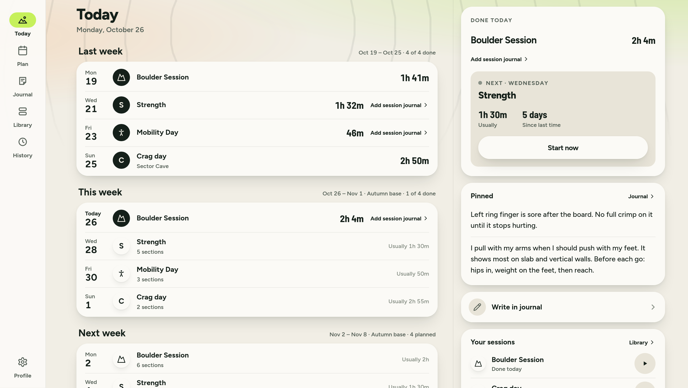</p>

## Plan

Plan your training in cycles.

<table>
  <tr>
    <td align="center">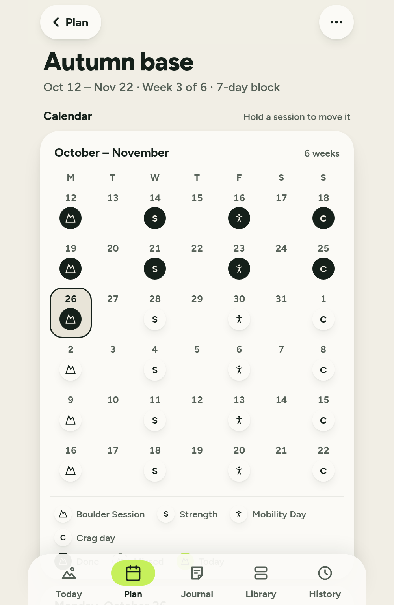<br>A cycle</td>
    <td align="center">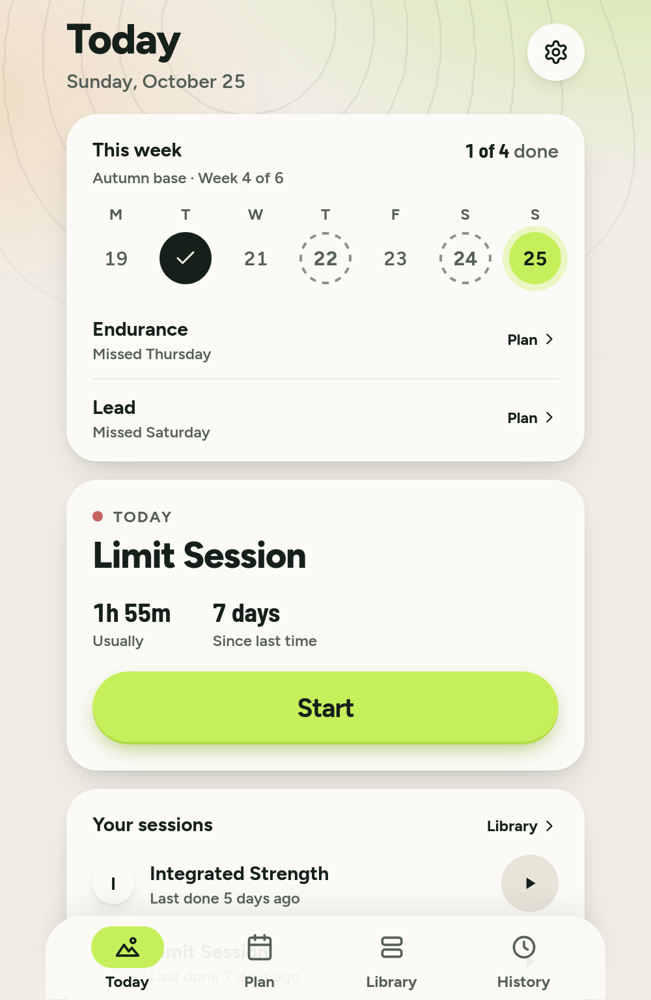<br>Today</td>
  </tr>
</table>

## Train

Run a session: hangs, sets and reps, climbs.

<table>
  <tr>
    <td align="center">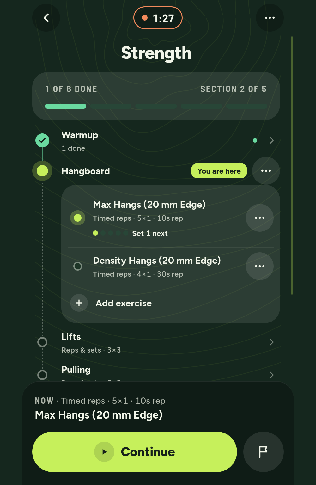<br>The session</td>
    <td align="center">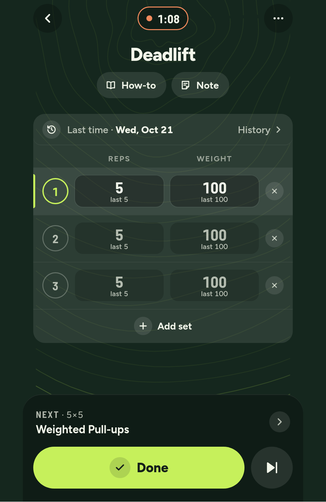<br>Sets</td>
  </tr>
  <tr>
    <td align="center">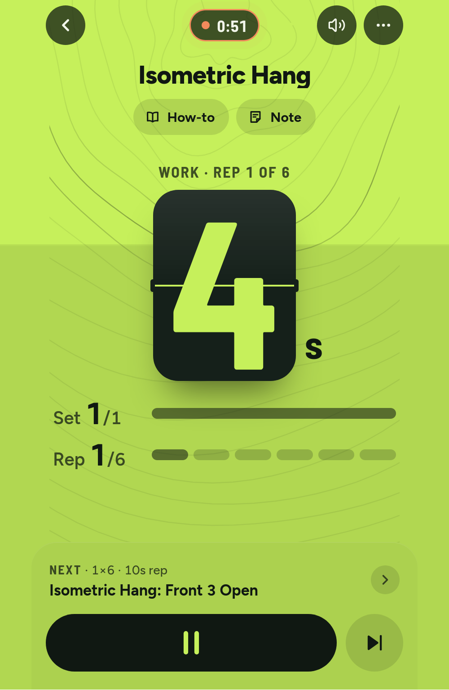<br>Hang timer</td>
    <td align="center">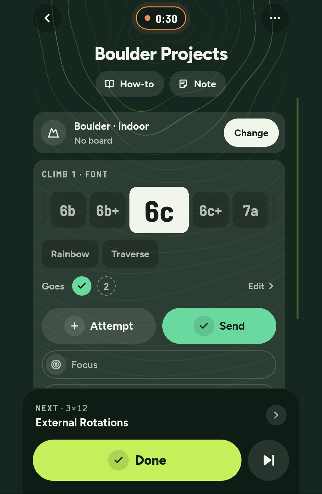<br>Climbs</td>
  </tr>
</table>

## Look back

See your hours, climbs and grades over time.

<table>
  <tr>
    <td align="center">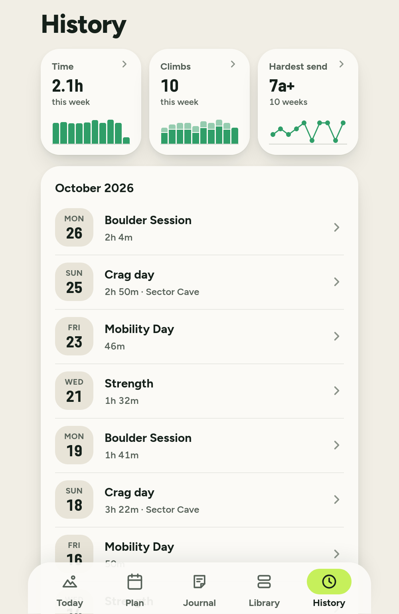<br>History</td>
    <td align="center">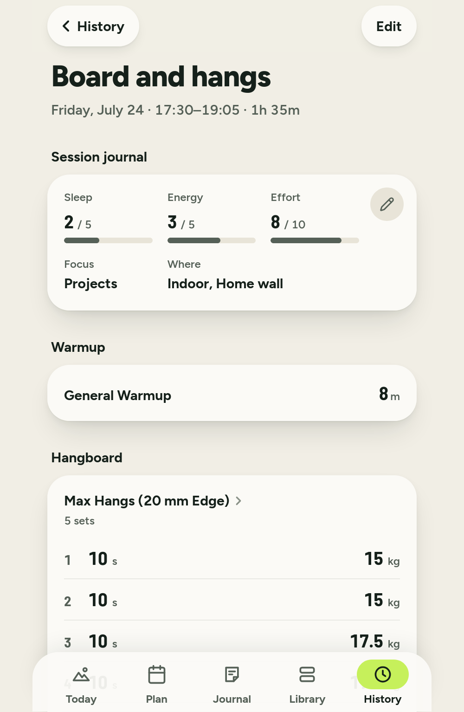<br>A past session</td>
  </tr>
  <tr>
    <td align="center">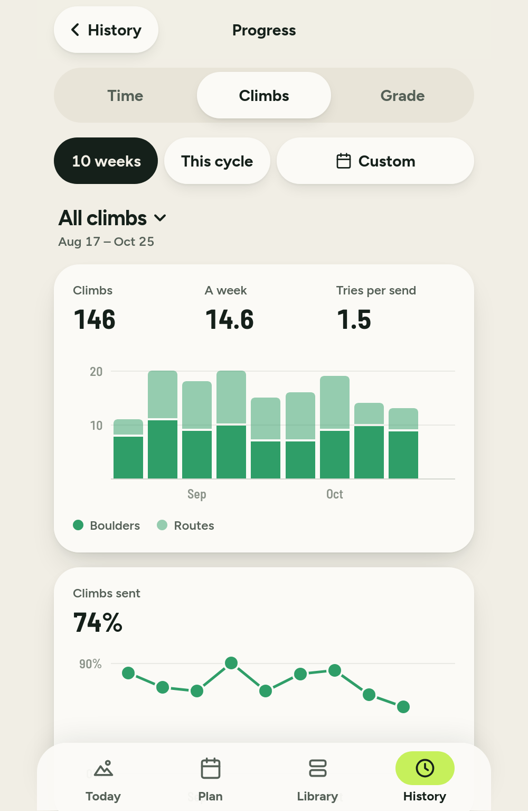<br>Progress</td>
    <td align="center">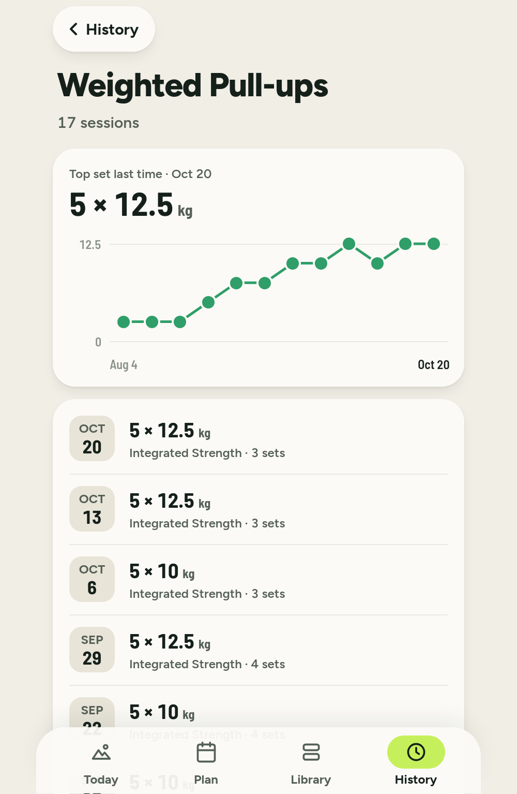<br>One exercise</td>
  </tr>
</table>

## Journal

Keep a training journal.

<table>
  <tr>
    <td align="center">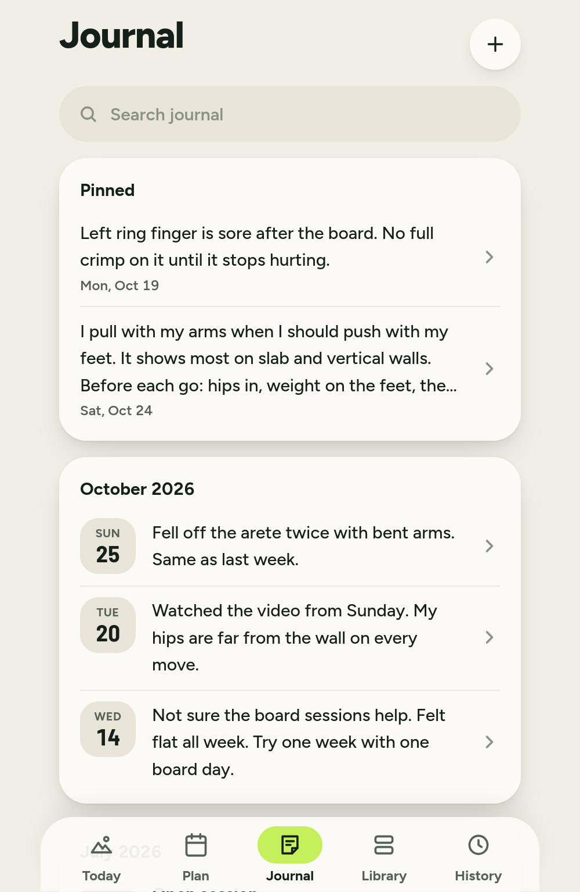<br>Journal</td>
    <td align="center">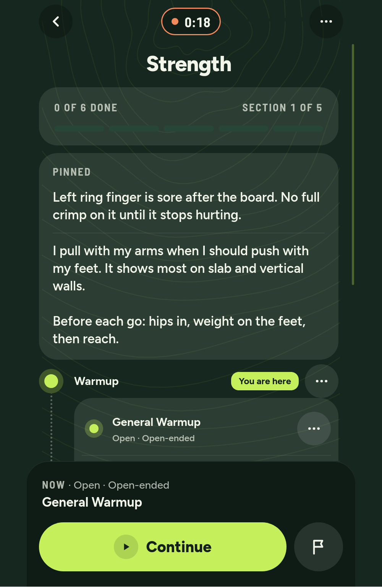<br>Pinned notes</td>
  </tr>
</table>

## Make your own

Use the exercises and sessions that come with the app, or build your own.

<table>
  <tr>
    <td align="center">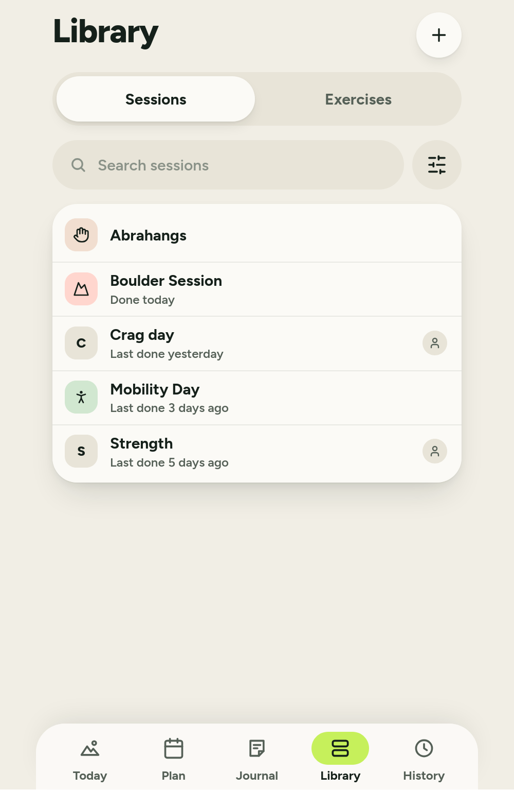<br>Library</td>
    <td align="center">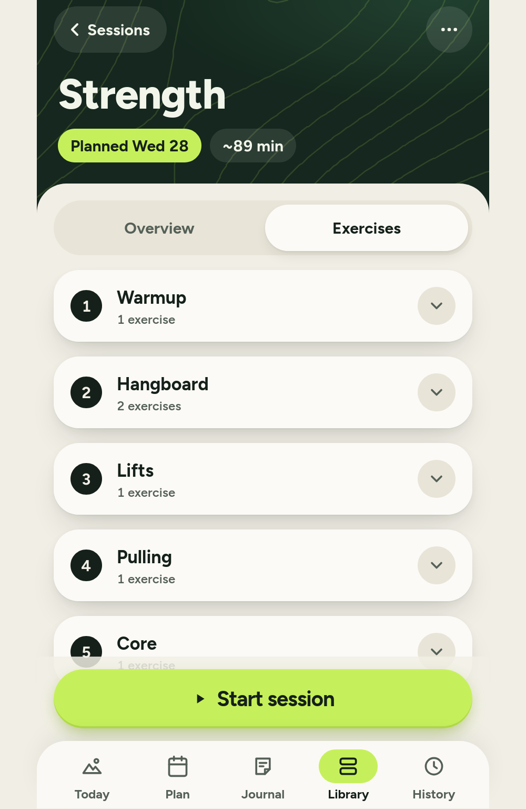<br>A session's sections</td>
  </tr>
</table>

## Run it

You need Docker and Postgres 18.

```sh
make image
docker run -e DATABASE_URL=postgres://... -p 8080:8080 passion:dev
```

Open <http://localhost:8080> and sign up. On an iPhone, add it to the Home Screen from Safari.

From source: install [nix](https://nixos.org), then run `nix develop` and `make run`.

## Docs

- [Deploy](docs/DEPLOY.md)
- [Develop](docs/DEVELOPMENT.md)
- [Catalog format](docs/CATALOG_FORMAT.md)
- API docs at `/api/docs/` on a running server

## Licence

[PolyForm Noncommercial 1.0.0](LICENSE).
