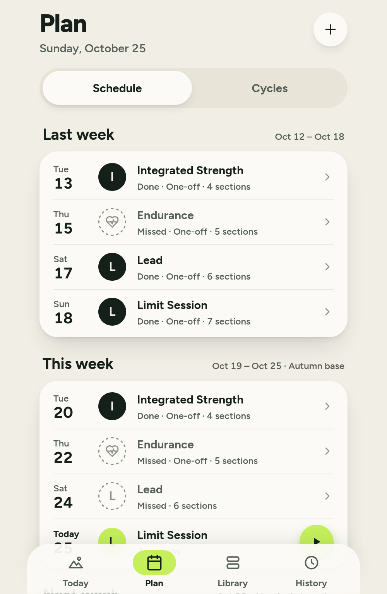

<h1 align="center">Passion</h1>

<p align="center">A training log and planner for climbers that you host yourself.</p>

<p align="center">
  
  
  
  
</p>

<p align="center"></p>

Passion is a training app for climbers. You use it to plan your training, log your sessions
and see your progress. It runs in a web browser on a phone or a computer. You host it on
your own server.

## Plan

A cycle is a block of days that repeats for some weeks. You put a session on each day that
you train. The Today page shows the session for today and your numbers from the last time.
It also lists your sessions and the date that you last did each one. Thus you can start a
session without a plan. A day that you miss stays on the calendar as missed.

<p align="center">
  
  
  
</p>

## Train

You do a session one step at a time. For each set, you log the reps and the weight. Your
numbers from the last time show below each field. Hangs and repeaters use a timer with
prep, work and rest. The timer sounds also play when an iPhone is on silent.

For climbs, you log each try as an attempt or a send. The app finds your sends and flashes
from these tries. You can add, move or skip exercises during the session. If you lose
signal, the phone keeps your log and sends it to the server later.

<p align="center">
  
  
  
</p>

## Look back

Each session keeps the plan and what you did. You can add a journal with your sleep, energy
and effort. The Progress page shows your hours, climbs and grades. It can show the last 10
weeks, one cycle, or the dates that you choose. Each exercise also has its own history.

<p align="center">
  
  
</p>
<p align="center">
  
  
</p>

## Make your own

The app comes with exercises and sessions that you can use. You can also make your own in
the app. A session has sections. A section can give a choice, for example "pick 1 of these
3". If you keep your training in files, you can load them as a private catalog. Only you can
see a private catalog.

Boulder grades show in Font or V. Route grades show in French or YDS.

## Run it

You need Docker and a Postgres 18 database.

```sh
make image
docker run -e DATABASE_URL=postgres://... -p 8080:8080 passion:dev
```

Open <http://localhost:8080> and sign up.

To add the app to an iPhone Home Screen, open it in Safari. Tap Share, then tap Add to Home
Screen. The Home Screen app has its own sign-in, so sign in again there.

To run the app from the source code, install [nix](https://nixos.org). Then run
`nix develop` and `make run`.

## Docs

- [Deploy](docs/DEPLOY.md): the configuration, the deploy workflow and backups.
- [Develop](docs/DEVELOPMENT.md): how to set up, where the code goes, and how to style a
  screen.
- [Catalog format](docs/CATALOG_FORMAT.md): how to write exercises and sessions as files.
- The API docs are at `/api/docs/` on a running server.

## Licence

[PolyForm Noncommercial 1.0.0](LICENSE).
